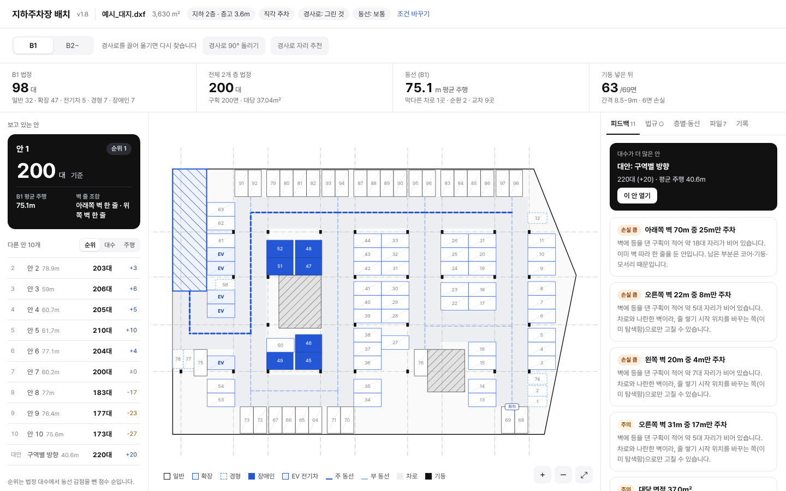

# parkplan · 지하주차장 최적 배치

[](https://github.com/UA-Studio/parkplan/actions/workflows/ci.yml)

**v1.7 (2026-11-23)**

지하 외벽선, 코어, 경사로를 그린 도면(DXF/3dm)을 넣으면 **주차장법을 지키면서 법정 주차대수가 가장 많은 지하주차장 배치**를 찾아 줍니다. 결과는 캐드(DXF), 라이노(3dm), 평면 그림, 층별 대수표로 받습니다.



## 무엇을 하나

- **주차 구획과 차로 배치**: 격자 방향, 주차 각도(직각·60°·45°), 확장형 줄 위치, 벽 따라 한 줄 배치를 바꿔 가며 수천~수만 개 안을 비교합니다.
- **기둥 배열**: 5~9m 간격 안에서 기둥 때문에 잃는 구획이 가장 적은 줄을 고릅니다.
- **동선 평가**: 평균 주행거리, 막다른 차로('회차'), 교차, 순환 고리를 따져 대수와 함께 순위를 매깁니다.
- **법규 확인**: 구획 크기, 확장형 30%, 장애인 3%, 경형 인정 한도, 전기차 5%, 차로 너비, 경사로 너비와 곡선 반경을 확인합니다.
- **법정 필요대수 목표**: 목표 대수를 넣으면 충족 여부와 부족분(필요 층수)을 보여 주고, 목표를 채운 안 가운데 동선이 좋은 안을 먼저 보여 줍니다.
- **정형 기둥 격자**: 기둥 줄을 같은 간격(예 8.5m)으로 고정하는 선택지. 자유 간격과의 대수 차이를 함께 보여 줍니다.
- **외벽 둘레 창고·기계실 띠**: 지하 외벽을 따라 정한 깊이만큼 비우고 안쪽에 주차를 배치합니다(경사로 앞은 비움).
- **피드백과 대안**: 비어 있는 벽, 기둥 손실, 남는 폭을 알려 주고 고친 대안을 함께 보여 줍니다.
- **경사로 끌어 옮기기, 자리 추천, 구역별 차로 방향, 일방통행 검사**

## 쓰는 법

### 1. 도면 준비
닫힌 폴리라인으로 그리고, 레이어 이름으로 역할을 구분합니다. 레이어 역할은 화면에서 바꿀 수 있습니다.

| 역할 | 레이어 이름 예 |
|---|---|
| 대지경계(지하 외벽 안쪽) | `대지`, `경계`, `외벽`, `SITE` |
| 코어 | `코어`, `CORE`, `EV`, `계단` |
| 경사로 | `경사로`, `램프`, `RAMP` |
| 장애물 | `기계실`, `전기실`, `DA`, `피트` |

DWG는 캐드에서 DXF로 저장해 넣으세요.

### 2. 받기와 실행 (Windows 10·11, 설치 필요 없음)
1. [**Releases**](https://github.com/UA-Studio/parkplan/releases/latest)에서 `parking_layout_windows_v…zip`을 받습니다.
2. 오른쪽 클릭 → **모두 압축 풀기**
3. 풀린 폴더의 **지하주차장 실행.bat**을 더블클릭합니다. "Windows의 PC 보호" 창이 뜨면 추가 정보 → 실행을 누릅니다.
4. 브라우저에 화면이 열립니다. 검은 창을 닫으면 프로그램이 꺼집니다.

파이썬은 묶음 안에 들어 있어 따로 설치하지 않습니다. 도면과 결과는 내 PC 밖으로 나가지 않습니다(결과: `C:\Users\내이름\지하주차장\`).

개발자는 `pip install -r requirements.txt` 뒤 `python -m parking_ai`(화면) 또는 `python -m parking_ai 도면.dxf`로 실행합니다.

### 3. 화면에서
1. 도면 넣기(또는 **예시 도면으로 해보기**)
2. 층수, 층고, 주차 각도, 경사로(그린 것/자동/없음), 동선 비중을 정함
3. **배치 찾기**: 예시 대지는 1분 안팎, 6만㎡급은 몇 분 걸립니다
4. 위쪽 탭에서 안을 비교하고, 오른쪽 피드백을 확인하고, 파일을 받음

### 4. 결과 파일
`배치.dxf`(원래 도면과 같은 좌표·단위), `모델.3dm`(층별 레이어), `B1_평면.png`, `층별대수.csv`, `요약.txt`, `통계.json`

## 법규 기본값 (화면 '세부 설정'에서 바꿈)

- 구획: 일반 2.5×5.0, 확장 2.6×5.2, 경형 2.0×3.6, 장애인 3.3×5.0 m
- 차로: 직각 6.0m, 60° 4.5m, 45° 3.5m
- 경사로: 직선 17%, 곡선 14%, 곡선 내변 반경 6m
- 기둥: 700×500, 간격 5~9m

⚠ 60°·45° 차로 너비와 장애인 비율(지자체 조례)은 사업지 기준으로 다시 확인하세요.

자세한 설명, 알고리즘, 판별 변경 이력은 [docs/사용법_상세.md](docs/사용법_상세.md)에 있습니다.

## 개발 방식

- `main`은 항상 시험을 통과한 상태로 유지합니다. 개선은 브랜치에서 하고 **PR**로 올립니다.
- 커밋할 때마다 GitHub Actions가 **Linux·Windows**에서 설치, 명령줄 실행, 출력 6종 확인, 기준 대수 회귀 시험을 돌립니다. Linux에서는 화면 시험(브라우저)도 함께 돌립니다. 결과 그림은 Actions 산출물로 남고, PR에는 확인 그림 댓글이 붙습니다.
- 기준 대수(1층, 동선 가중치 0): 예시 111, 사용자 근사 82, 큰 대지 331, 자동 경사로 338대. 이보다 적으면 실패입니다.
- **Windows 묶음**: 커밋마다 Actions가 무설치 묶음을 만들고, 깨끗한 Windows에서 한글 경로에 압축을 풀어 `지하주차장 실행.bat` → 출력 6종 → 화면 서버까지 시험합니다. PR에서는 Actions 산출물(`windows-zip`)로 미리 받아 볼 수 있습니다.
- **새 버전 내기**: `parking_ai/__init__.py`의 `VERSION`·`DATE`를 올린 PR이 main에 합쳐지면, 시험을 통과한 묶음이 Releases에 자동으로 올라갑니다. 파일 이름은 `parking_layout_windows_v{버전}_{날짜}.zip`입니다.
- 무거운 시험(6.4만㎡ 대지, 구역별 방향, 일방통행)은 주 1회 돌고, 필요하면 수동으로도 돌릴 수 있습니다.

```bash
pip install -r requirements.txt pytest
pytest tests/test_ci.py -v           # 커밋마다 도는 시험
pytest tests/test_gui.py -v          # 화면 시험 (playwright 필요)
```

## 저장소에 올리지 않는 것

- **개인 도면과 사업지 자료**: `.gitignore`가 `*.dxf`, `*.dwg`, `*.3dm`을 막습니다(합성 예시 `예시/예시_대지.dxf`만 예외). 자기 도면은 화면에서 직접 고릅니다.
- **재배포가 금지된 자료**(정밀도로지도 등): 저장소에 넣지 않고 사용자가 지정합니다.
- **인증키**: 코드나 저장소에 넣지 않습니다. 필요하면 GitHub Secrets나 화면 입력으로 받습니다.
